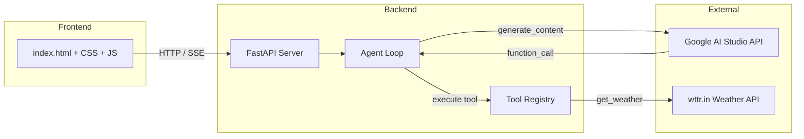

# 🤖 Gemma 4 AI Agent

[](https://python.org)
[](https://fastapi.tiangolo.com)
[](https://ai.google.dev)
[](LICENSE)

> **An agentic AI assistant powered by Google's Gemma 4 model with real tool-calling capabilities.**

Gemma 4 Agent is a full-stack application that showcases the agentic loop pattern: the model can call tools, receive results, reason about them, and deliver a final answer — all in a polished, ChatGPT-like interface.

<!-- Screenshot placeholder: add a screenshot of the running app here -->
<!--  -->

---

## 🏗️ Architecture



### Agentic Loop

```
User prompt
    │
    ▼
┌──────────────────────────┐
│  Send to Gemma 4 model   │◄──────────────────┐
│  (with tool schemas)      │                   │
└───────────┬──────────────┘                    │
            │                                   │
      ┌─────▼─────┐                             │
      │ Tool call? │── YES ──► Execute tool ────┘
      └─────┬─────┘           Send result back
            │ NO
            ▼
     Final text response
```

---

## ✨ Features

| Feature | Description |
|---------|-------------|
| 🔧 **Tool Calling** | 6 built-in tools the model can invoke autonomously |
| 🔄 **Agentic Loop** | Multi-round tool → result → reasoning → answer |
| 🌊 **Streaming** | Server-Sent Events for real-time token streaming |
| 💭 **Thinking Mode** | Gemma 4's chain-of-thought reasoning |
| 🎨 **Modern UI** | Dark-themed, responsive, animated chat interface |
| 📱 **Mobile Ready** | Fully responsive design with collapsible sidebar |

---

## 🛠️ Available Tools

| Tool | Description |
|------|-------------|
| `web_search(query)` | Simulated web search (swap in a real API) |
| `get_weather(city)` | Live weather via [wttr.in](https://wttr.in) |
| `calculate(expression)` | Safe math evaluator (AST-based) |
| `get_current_datetime()` | Current date and time |
| `get_news_headlines(topic)` | Simulated news headlines |
| `generate_code(language, description)` | Code template generator |

---

## 🚀 Quick Start

### 1. Get an API Key

1. Go to [Google AI Studio](https://aistudio.google.com/apikey)
2. Create a new API key
3. Copy it

### 2. Set Up the Project

```bash
# Clone / navigate to the project
cd gemma4-agent

# Create a virtual environment
python -m venv .venv
# Windows
.venv\Scripts\activate
# macOS/Linux
source .venv/bin/activate

# Install dependencies
pip install -r backend/requirements.txt

# Configure your API key
cp .env.example .env
# Edit .env and paste your API key
```

### 3. Run

```bash
python run.py
```

Open **http://localhost:8000** in your browser. That's it! 🎉

---

## 💬 Usage Examples

| Prompt | What happens |
|--------|-------------|
| *"What's the weather in Paris?"* | Agent calls `get_weather("Paris")` → formats result |
| *"Calculate sqrt(144) + 3^2"* | Agent calls `calculate("sqrt(144) + 3**2")` → returns 21 |
| *"Search the web for latest AI news"* | Agent calls `web_search(...)` → summarises results |
| *"Write a Python binary search function"* | Agent calls `generate_code(...)` → returns code |
| *"What time is it and what's the weather in Tokyo?"* | Agent chains **two** tool calls in sequence |

---

## 🔌 Adding Custom Tools

1. **Implement the function** in `backend/tools.py`:

```python
def my_tool(param1: str, param2: int) -> str:
    """Do something useful."""
    return f"Result for {param1} with {param2}"
```

2. **Register it** in the `TOOL_FUNCTIONS` dict:

```python
TOOL_FUNCTIONS["my_tool"] = my_tool
```

3. **Add the schema** to `FUNCTION_DECLARATIONS`:

```python
types.FunctionDeclaration(
    name="my_tool",
    description="Does something useful.",
    parameters=types.Schema(
        type=types.Type.OBJECT,
        properties={
            "param1": types.Schema(type=types.Type.STRING, description="..."),
            "param2": types.Schema(type=types.Type.INTEGER, description="..."),
        },
        required=["param1", "param2"],
    ),
),
```

4. Restart the server — the new tool appears automatically in the UI and is available to the model.

---

## 📁 Project Structure

```
gemma4-agent/
├── backend/
│   ├── main.py            # FastAPI server + routes
│   ├── agent.py           # Agentic loop & Gemma 4 integration
│   ├── tools.py           # Tool implementations & schemas
│   ├── config.py          # Configuration & env vars
│   └── requirements.txt   # Python dependencies
├── frontend/
│   ├── index.html         # Chat UI
│   ├── styles.css         # Styling
│   └── app.js             # Frontend logic
├── .env.example           # Environment variable template
├── run.py                 # One-command launcher
├── LICENSE                # Apache 2.0
└── README.md              # This file
```

---

## 🧰 Tech Stack

- **Model**: [Google Gemma 4 12B-IT](https://ai.google.dev) via Google AI Studio
- **Backend**: [FastAPI](https://fastapi.tiangolo.com) + [Uvicorn](https://www.uvicorn.org)
- **SDK**: [`google-genai`](https://pypi.org/project/google-genai/) Python SDK
- **Frontend**: Vanilla HTML / CSS / JavaScript (zero dependencies)
- **Weather API**: [wttr.in](https://wttr.in) (free, no key required)

---

## 📄 License

This project is licensed under the **Apache License 2.0** — see the [LICENSE](LICENSE) file for details.

